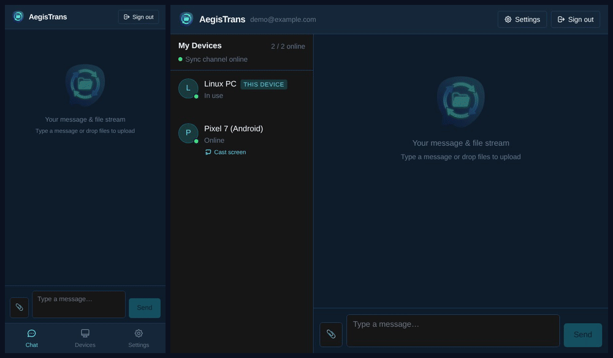
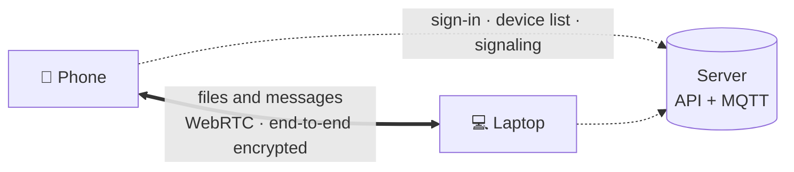

<p align="center">
  
</p>

<h1 align="center">AegisTrans</h1>

<p align="center">
  <b>Send files to your own devices — end-to-end encrypted, peer-to-peer, no cloud.</b><br>
  English · <a href="README.zh-TW.md">繁體中文</a>
</p>

<p align="center">
  
</p>

## Install

- **Android** — download the APK from [Releases](../../releases/latest) and open it (allow "install unknown apps" when asked).
- **Any browser** — open [trans.aegisrd.com](https://trans.aegisrd.com). Nothing to install.
- **Desktop and iOS** — build from source for now (see [Building](#building)).

Sign up with an email on one device, then sign in with the same email on the next. That's the pairing — no QR codes, no codes to type.

## Features

- **Peer-to-peer** — files go straight from device to device over WebRTC. No cloud copy, no relay server.
- **End-to-end encrypted** — X3DH + Double Ratchet in a Rust → WebAssembly core. Keys never leave your devices.
- **Original files** — no compression, EXIF and RAW kept, any file type, no links that expire.
- **Every platform** — Android, iOS, Windows, macOS, Linux and any modern browser.
- **Our server or yours** — the official server by default; switch to your own in Settings → Server.

## How it works



The server knows your email address and your device list, and passes encrypted signaling between your devices. It never receives file contents. Messages for an offline device wait on the broker as encrypted envelopes; files are fetched directly from your other device once both are online. There is no TURN relay by design (STUN is used only to discover the network path), so two networks that block every direct connection cannot transfer.

## Self-hosting

Run the API, an MQTT broker and the web app yourself, then point the app at your server in Settings → Server: [docs/SELF_HOSTING.md](docs/SELF_HOSTING.md).

## Building

Requirements: Node.js 20+, Rust (rustup) and `wasm-pack` 0.13.1 for the encryption core, Android Studio or Xcode for the mobile apps.

```bash
cd packages/aegis-display && npm install
cd ../pwa && npm ci
npm run build            # compiles the crypto core from source if missing, then the web app
npm run android:build    # then build packages/pwa/android with Android Studio or Gradle
```

The encryption core builds reproducibly: [packages/crypto-core](packages/crypto-core/README.md) and [BUILD_PROVENANCE.md](BUILD_PROVENANCE.md).

| Path | What |
|---|---|
| `packages/pwa` | The app — React PWA; Android and iOS via Capacitor, desktop via Electron |
| `packages/crypto-core` | X3DH + Double Ratchet core (Rust, compiled to WebAssembly) |
| `packages/aegis-display` | Screen-sharing / virtual display plugin |
| `api` | FastAPI server (`api/app.py` for self-hosting) |
| `scripts/check-*` | Regression checks |

## Roadmap

- [x] Android, iOS, desktop and web clients
- [x] Self-hosting and in-app server switch
- [x] Open-source release (MIT)
- [ ] Desktop and iOS builds in Releases
- [ ] Google Play and App Store listings
- [ ] Verifiable builds: check that a released APK matches this source

Changes per release: [CHANGELOG.md](CHANGELOG.md).

## Contributing

Issues and pull requests are welcome — see [CONTRIBUTING.md](CONTRIBUTING.md). Please report security problems privately as described in [SECURITY.md](SECURITY.md).

## License

[MIT](LICENSE). Third-party components: [THIRD_PARTY_NOTICES.md](THIRD_PARTY_NOTICES.md).
