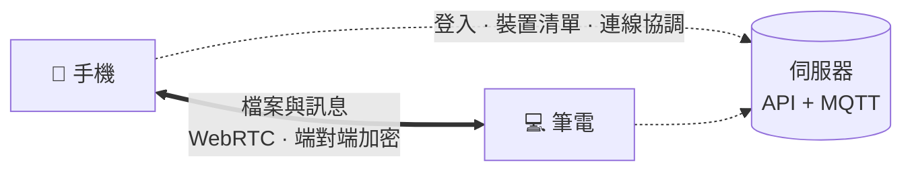

<p align="center">
  
</p>

<h1 align="center">AegisTrans</h1>

<p align="center">
  <b>把檔案傳給自己的其他裝置——端對端加密、裝置直連、不經過雲端。</b><br>
  <a href="README.md">English</a> · 繁體中文
</p>

<p align="center">
  
</p>

## 安裝

- **Android**：到 [Releases](../../releases/latest) 下載 APK 並開啟（系統詢問時，允許「安裝不明應用程式」）。
- **任何瀏覽器**：打開 [trans.aegisrd.com](https://trans.aegisrd.com)，不用安裝。
- **桌面版與 iOS**：目前請從原始碼建置（見[建置](#建置)）。

在一台裝置用 email 註冊，另一台用同一個 email 登入，就完成配對了。不用掃 QR，也不用輸入配對碼。

## 功能

- **裝置直連**：檔案透過 WebRTC 從一台裝置直接傳到另一台，雲端不留副本，也沒有中繼伺服器。
- **端對端加密**：用 X3DH 與 Double Ratchet，加密核心以 Rust 寫成並編譯為 WebAssembly。金鑰只存在你的裝置上。
- **原檔傳送**：不壓縮，保留 EXIF 與 RAW，任何檔案類型都可以，也沒有會過期的連結。
- **全平台**：Android、iOS、Windows、macOS、Linux 與一般瀏覽器。
- **用官方伺服器或自己架**：預設連官方伺服器，可在「設定 → 伺服器」改成你自己的。

## 運作方式



伺服器知道你的 email 和裝置清單，並在你的裝置之間轉交加密的連線協調訊息，但不會收到檔案內容。給離線裝置的訊息，會以加密封包的形式暫存在推播伺服器；檔案則等兩台都上線後，直接從你的另一台裝置取得。我們刻意不設 TURN 中繼伺服器，STUN 只用來找出連線路徑，所以如果兩邊的網路都擋掉直連，就沒辦法傳送。

## 自架伺服器

自己架 API、MQTT 推播伺服器與網頁版，再到 App 的「設定 → 伺服器」改成你的伺服器：[docs/SELF_HOSTING.md](docs/SELF_HOSTING.md)（英文）。

## 建置

需要 Node.js 20 以上；建置加密核心需要 Rust（rustup）與 `wasm-pack` 0.13.1；手機版需要 Android Studio 或 Xcode。

```bash
cd packages/aegis-display && npm install
cd ../pwa && npm ci
npm run build            # 缺加密核心時會先從原始碼編譯，再建置網頁版
npm run android:build    # 接著用 Android Studio 或 Gradle 建置 packages/pwa/android
```

加密核心可重現建置：見 [packages/crypto-core](packages/crypto-core/README.md) 與 [BUILD_PROVENANCE.md](BUILD_PROVENANCE.md)。

| 路徑 | 內容 |
|---|---|
| `packages/pwa` | App 本體：React PWA；Android／iOS 用 Capacitor，桌面版用 Electron |
| `packages/crypto-core` | X3DH 與 Double Ratchet 加密核心（Rust，編譯為 WebAssembly） |
| `packages/aegis-display` | 螢幕分享／虛擬螢幕外掛 |
| `api` | FastAPI 伺服器（自架用 `api/app.py`） |
| `scripts/check-*` | 回歸檢查 |

## 路線圖

- [x] Android、iOS、桌面與網頁版
- [x] 自架伺服器與 App 內切換伺服器
- [x] 開源（MIT）
- [ ] 桌面版與 iOS 版放上 Releases
- [ ] 上架 Google Play 與 App Store
- [ ] 可驗證建置：確認發布的 APK 與這份原始碼一致

各版本變更：[CHANGELOG.md](CHANGELOG.md)。

## 參與貢獻

歡迎開 issue 或送 pull request，請先看 [CONTRIBUTING.md](CONTRIBUTING.md)（英文）。資安問題請依 [SECURITY.md](SECURITY.md) 私下回報，不要公開開 issue。

## 授權

[MIT](LICENSE)。第三方元件：[THIRD_PARTY_NOTICES.md](THIRD_PARTY_NOTICES.md)。
